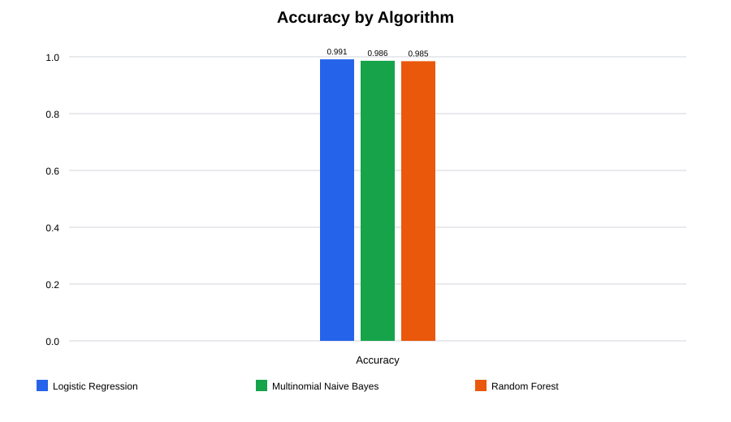
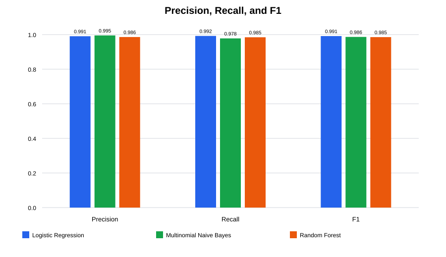
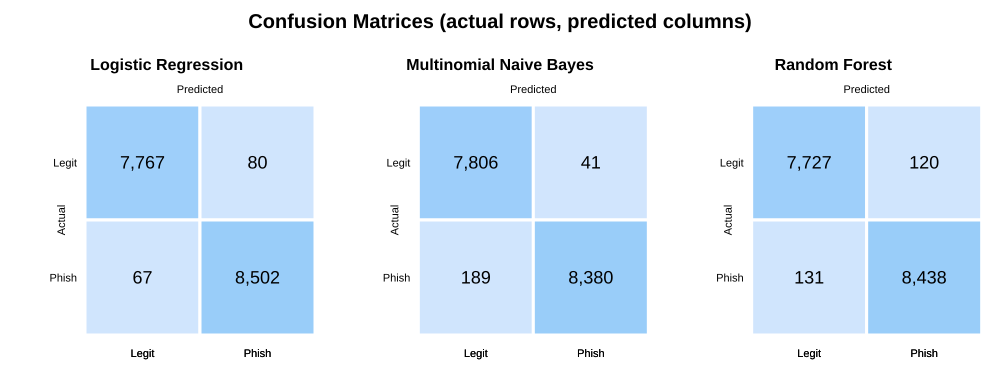
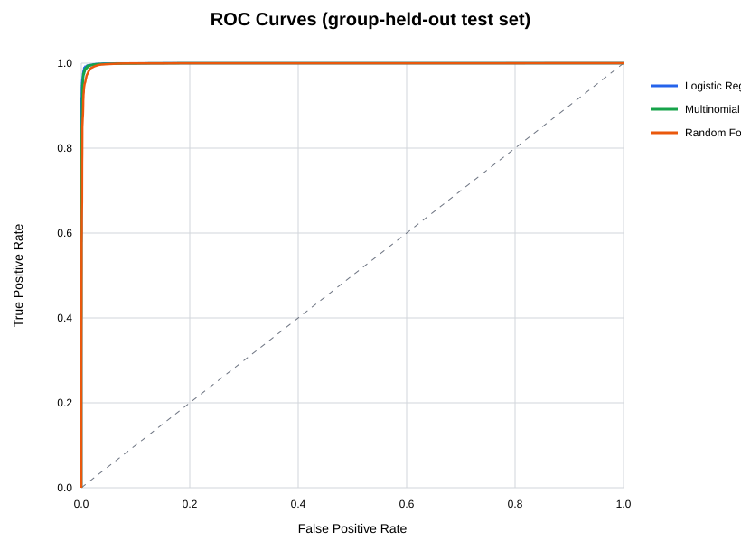

# Comparative Algorithm Evaluation: Email Phishing Detection

**Run date:** 2026-11-01  
**Dataset:** `cleaned_dataset.csv` (original source CSV was not modified)  
**Rows:** 82,077; features: `text_combined`; target: `label` (0=legitimate, 1=phishing)  
**Grouped split seed:** 42; **group-aware CV folds:** 3

## Dataset and experimental methodology

- Reused `grouped_split_manifest.csv` for every model. Training rows: 65,661; holdout rows: 16,416 (20.00%). Training labels: `{0: 31386, 1: 34275}`; holdout labels: `{0: 7847, 1: 8569}`.
- The manifest contains 78,263 similarity groups. A validation check confirmed zero group IDs overlap between train and test. All three algorithms received exactly the same text and labels in each partition.
- Text normalization lowercases and collapses whitespace without removing URL/security wording. Each pipeline uses word-level TF-IDF with unigrams and bigrams, no stop-word removal, and a 200,000-feature cap.
- Hyperparameters were selected by 3-fold `StratifiedGroupKFold` on training records only (seed 42), optimizing phishing F1. Each CV fold had disjoint group IDs, and TF-IDF lived inside the pipeline, so it was fit only on that fold's training text. The grouped holdout was used only for final evaluation.
- After tuning, the best configuration was refit on the complete grouped training partition. Reported training time is this final TF-IDF plus model fit; tuning time is also saved in `algorithm_comparison_results.csv`. Prediction time includes TF-IDF transform and `predict_proba` for the holdout, reported per email.
- All models use default unweighted classes because training classes are close in size. The Naive Bayes smoothing value and model-specific parameters were tuned using CV, not the holdout.

## Model configurations

- **Logistic Regression** (best group-CV F1 0.9900): `{"classifier__C": 4.0}`
- **Multinomial Naive Bayes** (best group-CV F1 0.9847): `{"classifier__alpha": 0.1}`
- **Random Forest** (best group-CV F1 0.9806): `{"classifier__max_depth": null, "classifier__min_samples_leaf": 1}`

Search grids were intentionally bounded for a reproducible comparison. Logistic Regression searched `C` in {0.25, 1, 4}; Multinomial Naive Bayes searched `alpha` in {0.1, 0.5, 1}; Random Forest used 75 trees and searched `max_depth` in {30, None} and `min_samples_leaf` in {1, 3}, with `max_features='sqrt'`. Search selection used training-fold F1 only.

## Performance comparison

| Algorithm | Accuracy | Precision | Recall | F1 | ROC-AUC | Final fit (s) | Prediction (ms/email) |
|---|---:|---:|---:|---:|---:|---:|---:|
| Logistic Regression | 0.9910 | 0.9907 | 0.9922 | 0.9914 | 0.9995 | 50.47 | 0.308 |
| Multinomial Naive Bayes | 0.9860 | 0.9951 | 0.9779 | 0.9865 | 0.9993 | 2.00 | 0.252 |
| Random Forest | 0.9847 | 0.9860 | 0.9847 | 0.9853 | 0.9983 | 213.91 | 0.396 |

**Tuning time (seconds):** Logistic Regression: 195.70; Multinomial Naive Bayes: 80.58; Random Forest: 784.63.  
**Selected by holdout F1 for recommendation:** Logistic Regression (F1 0.9914, recall 0.9922, ROC-AUC 0.9995). This is a comparison among the tested candidates, not an independent estimate beyond this one grouped holdout.

### Accuracy



### Precision, recall, and F1



### Confusion matrices



### Logistic Regression

Rows are actual classes; columns are predicted classes (0=legitimate, 1=phishing).

|  | Predicted legitimate | Predicted phishing |
|---|---:|---:|
| Actual legitimate | 7,767 | 80 |
| Actual phishing | 67 | 8,502 |

```text
                  precision    recall  f1-score   support

Legitimate Email       0.99      0.99      0.99      7847
  Phishing Email       0.99      0.99      0.99      8569

        accuracy                           0.99     16416
       macro avg       0.99      0.99      0.99     16416
    weighted avg       0.99      0.99      0.99     16416
```
### Multinomial Naive Bayes

Rows are actual classes; columns are predicted classes (0=legitimate, 1=phishing).

|  | Predicted legitimate | Predicted phishing |
|---|---:|---:|
| Actual legitimate | 7,806 | 41 |
| Actual phishing | 189 | 8,380 |

```text
                  precision    recall  f1-score   support

Legitimate Email       0.98      0.99      0.99      7847
  Phishing Email       1.00      0.98      0.99      8569

        accuracy                           0.99     16416
       macro avg       0.99      0.99      0.99     16416
    weighted avg       0.99      0.99      0.99     16416
```
### Random Forest

Rows are actual classes; columns are predicted classes (0=legitimate, 1=phishing).

|  | Predicted legitimate | Predicted phishing |
|---|---:|---:|
| Actual legitimate | 7,727 | 120 |
| Actual phishing | 131 | 8,438 |

```text
                  precision    recall  f1-score   support

Legitimate Email       0.98      0.98      0.98      7847
  Phishing Email       0.99      0.98      0.99      8569

        accuracy                           0.98     16416
       macro avg       0.98      0.98      0.98     16416
    weighted avg       0.98      0.98      0.98     16416
```

### ROC curves



## Advantages and limitations

- **Logistic Regression:** suited to sparse high-dimensional TF-IDF and provides a fast, interpretable linear baseline. It can miss nonlinear feature interactions and its probabilities still require calibration checks.
- **Multinomial Naive Bayes:** simple and usually fast for word-count/TF-IDF features; useful as a lightweight baseline. Its conditional-independence assumption is unrealistic for language, and probabilities can be poorly calibrated.
- **Random Forest:** can model nonlinear feature interactions and offers feature-importance tools. On sparse text with many mostly-zero features it can be slower, larger, and less effective than linear models; its probabilities may need calibration.

Measured fit and prediction times above should guide operational tradeoffs for this dataset and machine, rather than general algorithm claims.

## Recommendation

The tested candidate with the highest holdout F1 is **Logistic Regression**. The evidence is the grouped-holdout F1 of 0.9914, phishing recall of 0.9922, ROC-AUC of 0.9995, and measured timing in the table. Before deployment, confirm that its false-positive and false-negative costs are acceptable, review its error examples, and validate on a separate temporal or source-separated dataset. The tuned model comparison must not be interpreted as proof of future performance from one holdout alone.

## Saved artifacts

Each model and its fitted vectorizer are separate Joblib files:

- `comparison_logistic_regression_model.pkl` and `comparison_logistic_regression_tfidf.pkl`
- `comparison_multinomial_nb_model.pkl` and `comparison_multinomial_nb_tfidf.pkl`
- `comparison_random_forest_model.pkl` and `comparison_random_forest_tfidf.pkl`

Charts are generated as SVG without a plotting-library dependency. Detailed machine-readable results, including best parameters and tuning times, are in `algorithm_comparison_results.csv`.
